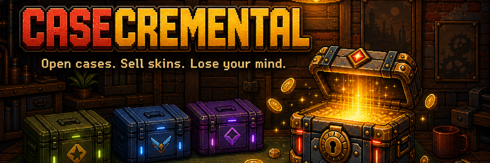

<p align="center"></p>

# Casecremental

An incremental game where every scratch ticket is a CS-style weapon case. You buy a case, turn the key and watch the reel tease reds and knives before it lands. Then you sell the skin and grow a pixel-art workbench from a single case into a busy machine shop. The game's intensity climbs from Sober to Unhinged, and the music changes with it.

**Play:** https://zvkc34tr.idos.games/ · [idosgames.com/app/ZVKC34TR](https://idosgames.com/app/ZVKC34TR/)

## Trailer


https://github.com/user-attachments/assets/b9c16a0f-0d17-446a-9220-ec6fa670daf5


## The game

- **The reel:** a CS-style spin that teases every red and knife. The rarity ladder runs Mil-Spec, Restricted, Classified, Covert and ★. Each skin also rolls a wear and a chance of StatTrak.
- **A four-run campaign:**
  - Run 1 brings the bot and the auto-seller.
  - Run 2 brings the locker and trade-up contracts.
  - Run 3 brings the auto contract and ×5 multi-open.
  - Run 4 brings the Upgrader and five evolutions.
  - Each run ends with a jackpot-style vault opening, with a devil key, beams and a fanfare.
  - Run 4's vault is **The Last Case**: the screen tears, every reel spins, and the credits roll.
- **Machines:** a case-opening bot, an auto-seller with a claim tray, a locker that presses trade-ups, and an auto-spinner for your own bench.
- **Between runs:** prestige pays CLOUT, you pick charms for the next run, and you buy permanent perks.
- **Server:** CLOUT, a Trophy Case and a `best_run` leaderboard live on the iDosGames Title. CloudCode handlers enforce caps based on server time. The game keeps an offline queue, so it never blocks play.
- **Accounts:** players can sign in with a Solana wallet. Cases are bought only with in-game cash, never crypto.
- **Polish:** a tutorial for new players, English and Russian, and a photosensitivity-safe effects budget (at most 3 flashes a second).

## Stack

React 19, TypeScript (strict) and Vite on the iDosGames SDK (`@idosgames/*`). PixiJS 8 renders the pixel world and the HD effects layer. Vitest covers the simulation and every pure rule. The audio and art were generated with ElevenLabs and built by the scripts in `tools/`.

## Running it

```bash
npm install
npm run dev        # http://localhost:5180
```

Local settings go in `.env.local`, which is gitignored:

```bash
VITE_IDOS_ENV=dev                      # which copy of the Title a local run uses: dev or prod
VITE_WALLETCONNECT_PROJECT_ID=...      # needed for wallet sign-in
```

Hosted builds read the Title id from `src/idos.title.ts` and pick dev or prod from their address (`{id}-dev.idos.games` or `{id}.idos.games`).

| Script | What it does |
|---|---|
| `npm run dev` | dev server |
| `npm run build` | production build into `dist/` |
| `npm run typecheck` | `tsc --noEmit` |
| `npm test` | the full Vitest suite, including the pacing tests that play whole runs |
| `npm run art` | rebuilds sprites from `art/source` using `art/manifest.json` |
| `npm run cloud` | bundles `cloudcode/casecremental.js` for publishing |

## Layout

```
src/base/                      sign-in screen and lobby (the host's base)
src/modules/casecremental/
  sim/                         pure TypeScript simulation: content, tuning, runs, machines, pacing player
  fx/                          PixiJS renderer: pixel world, reels, stations, vaults, finale, audio
  ui/                          React panels: shelf, drawer, machines, tutorial, prestige, credits
  game/                        controller, save (versioned, per account), view, agent surface
  meta/                        server bridge: offline queue, merge, Trophy Case and Leaderboard tabs
  i18n/                        English and Russian
cloudcode/                     CloudCode handlers (endRun, reportTrophy, buyPerk, saveMeta, loadMeta)
art/, tools/                   art pipeline sources and build scripts
docs/                          specs, plans and feature history (why things are built the way they are)
```

All balance numbers live in `sim/tuning.ts`, and `sim/pacing.test.ts` checks them against run-length targets for a perfect player and a casual one. The design decisions behind each system are in [docs/feature-history](docs/feature-history/README.md).

## Agents

AI coding agents working on this repo should read `IDOS.md` first (`AGENTS.md` and `CLAUDE.md` point to it).
